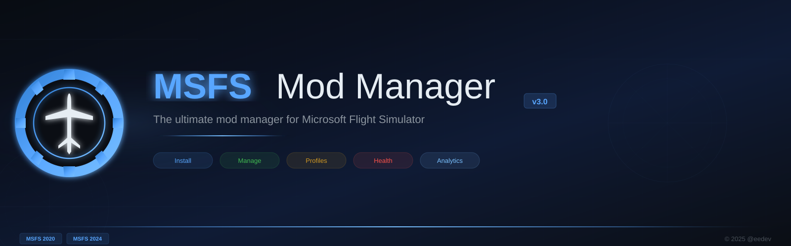

# MSFS Mod Manager v3.0

The ultimate mod manager for Microsoft Flight Simulator 2020 & 2024.



## Download

**[Download Latest Release](https://github.com/eedevv/msfs-mod-manager/releases/latest)** — Single .exe, no installation needed. Just download and run.

## Features

**Core:**
- **Install Mods** — Drag & drop ZIP/7z/RAR files or use the Install button
- **Enable/Disable** — Toggle mods instantly with NTFS junctions (no file copying)
- **Smart Search** — Filter by name, `type:aircraft`, `creator:pmdg`, `status:disabled`
- **Batch Operations** — Right-click to enable/disable/uninstall multiple mods
- **Double-Click Toggle** — Fastest way to enable/disable a mod

**Organization:**
- **Profiles** — Save mod configurations and switch between setups
- **Mod Groups** — Tag mods as Favorites, Testing, Broken, or custom groups
- **Mod Notes** — Add personal tags and notes to any mod

**Safety:**
- **Backup Manager** — Create, restore, compress, and clean mod backups
- **Conflict Scanner** — Detect file conflicts between mods
- **Health Checker** — Validate mod structure, manifests, and integrity
- **Security Scanner** — Checks for dangerous files before installation

**Intelligence:**
- **Storage Analytics** — Disk usage breakdown, largest mods dashboard
- **Watch Folder** — Monitors Downloads for new mod archives, notifies you
- **Mod Update Tracker** — Detects when installed mods have changed
- **Import from Other Managers** — Migrate from MSFS Addons Linker and others

**Polish:**
- **14 Languages** — English, German, Russian, French, Spanish, Arabic, Portuguese, Italian, Japanese, Korean, Chinese, Turkish, Polish, Dutch
- **Auto-Detection** — Finds MSFS 2020/2024 (MS Store, Steam, custom paths)
- **V2 Migration** — Imports profiles and settings from the V2 batch tool
- **First-Time Tutorial** — Guided walkthrough for new users
- **System Tray** — Minimize to tray option

## Keyboard Shortcuts

| Shortcut | Action |
|----------|--------|
| `Ctrl+I` | Install mods |
| `Ctrl+R` | Refresh mod list |
| `Ctrl+E` | Export mod list to Desktop |
| `Ctrl+A` | Select all mods |
| `Ctrl+1-6` | Switch pages |
| `Double-click` | Toggle mod enable/disable |

## Tech Stack

- **C# / .NET 8** — Native Windows, self-contained single-file exe (~70MB)
- **WPF** — Modern dark UI with animations and glassmorphism
- **SQLite** — Local database for mod index, history, profiles
- **NTFS Junctions** — Zero-copy enable/disable (no admin required)

## Build from Source

```bash
# Prerequisites: .NET 8 SDK
dotnet build
dotnet run --project src/ModInstaller.App

# Publish single-file exe
dotnet publish src/ModInstaller.App -c Release -r win-x64 --self-contained \
  -p:PublishSingleFile=true -p:EnableCompressionInSingleFile=true -o publish
```

## Project Structure

```
src/
├── ModInstaller.Core/          # Class library
│   ├── Models/                 # Data models (Mod, Profile, Settings)
│   ├── Services/               # Business logic (Scanner, Installer, Backup, etc.)
│   ├── Database/               # SQLite storage layer
│   └── Utils/                  # File operations, junction helpers
│
└── ModInstaller.App/           # WPF application
    ├── Views/                  # UI panels (Backup, Profile, Conflict, Health, etc.)
    ├── ViewModels/             # MVVM view models
    ├── Themes/                 # Dark theme, animations
    ├── Resources/              # Icons, brand assets
    └── Converters/             # Value converters
```

## History

This project started as a 3,000-line Windows batch script ([MSFS Easy Mod Installer V2](https://flightsim.to/file/94091/msfs-mod-installer)) published on FlightSim.to in 2025. V3 is a complete ground-up rewrite as a native Windows application.

## Support

If you find this tool useful, consider supporting development:

[](https://www.patreon.com/eedevv)

## License

MIT License — see [LICENSE](LICENSE) for details.

---

Made with care by [@eedev](https://github.com/eedevv)
